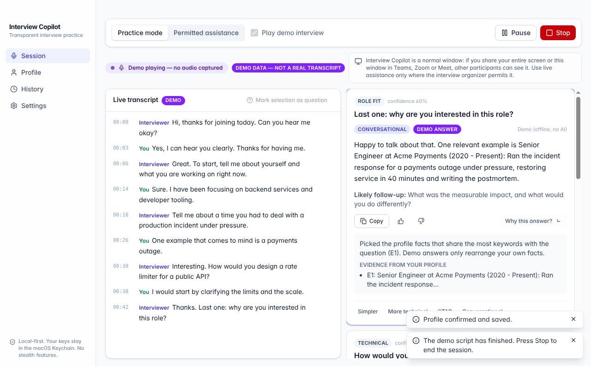
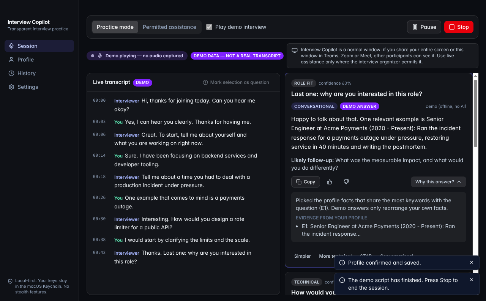
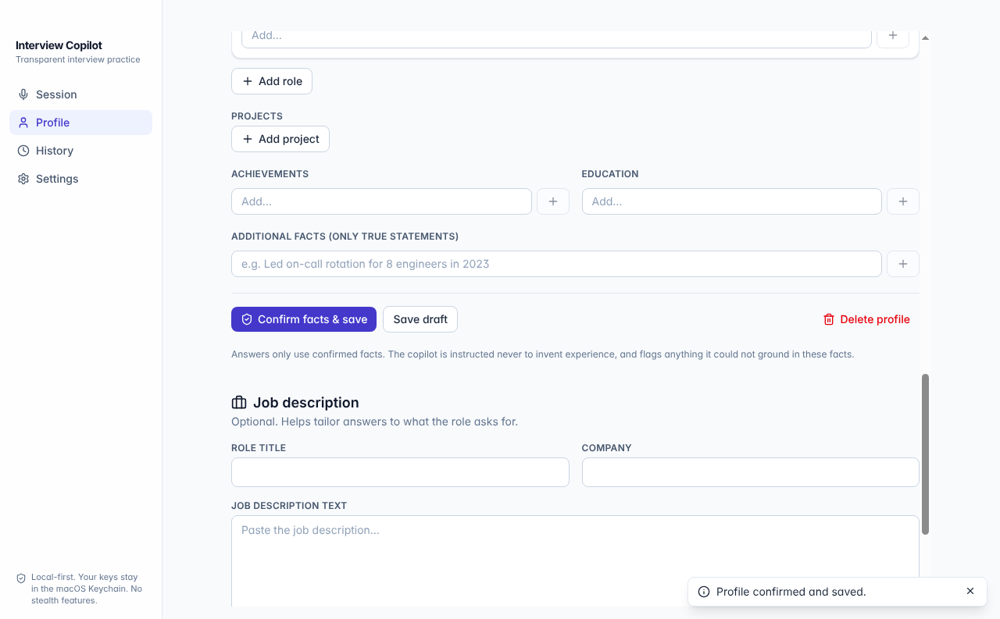
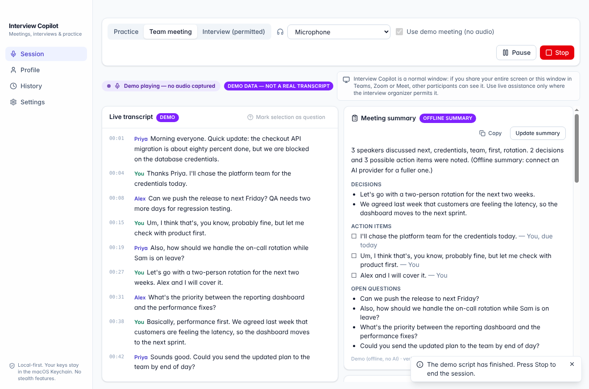

# Interview Copilot

A polished, **transparent** desktop copilot for interview preparation and **permitted** live
assistance on macOS. It listens to your microphone and/or system audio (only after you press
Start), transcribes the conversation, detects interviewer questions, and suggests short answers
grounded in **your own confirmed resume facts** — never invented ones.



| Dark mode | Profile review |
| --- | --- |
|  |  |



## Highlights

- **Separate answer window + background mode** — pop out a compact, read-only answer window you
  can keep on a second monitor or beside your meeting app; the dashboard keeps capturing and
  generating answers while minimized. It is an ordinary window (no screen-capture evasion): share
  a single application window, or your other display, so it isn't in your shared view.
- **Team meeting mode** (for leads and anyone who wants to communicate better at work)
  - Suggested replies when a teammate asks you something: calm, respectful, decisive, ending
    with a next step. Styles: *Shorter*, *More diplomatic*, *Warmer*, *More technical*.
  - Replies only state facts from your **meeting notes / agenda** and confirmed profile; when
    the notes don't cover something you get a good holding response instead of a guess.
  - **Private communication coach**: your talk-time share, speaking pace, filler words
    ("um", "you know", "basically"…), questions asked, with gentle tips. Computed on your Mac.
  - **One-click meeting summary**: key points, decisions, action items (owner + due date when
    stated) and open questions, copyable as Markdown and saved in history.
- **Three clearly labelled modes**: Team meeting, Practice and Interview (permitted)
  - **Practice** — mock questions (general + tailored to your job description), typed
    questions, or a scripted demo interview. Works offline with no API key.
  - **Interview (permitted)** — live transcription + answer suggestions. Requires you to confirm the
    interview organizer permits AI assistance before every session.
- **Live transcript** with partial/final updates, timestamps and **You / Interviewer** labels
  (microphone and system audio are kept on separate channels).
- **Question detection** — local, debounced, de-duplicated; ignores small talk and your own
  speech; mark any line or selection as a question manually.
- **Grounded answers** — concise / conversational / technical / STAR; direct first sentence;
  evidence citations; "Why this answer?"; general knowledge shown separately from personal
  experience; unsupported claims flagged; *"Your resume doesn't provide enough detail to answer
  this accurately"* when evidence is missing. Copy, rate, regenerate, cancel.
- **Resume & job context** — import PDF/DOCX/TXT or paste text, parsed **locally**; review and
  edit extracted skills, experience, projects and achievements; confirm before use.
- **Privacy by default** — bring your own keys (stored in the macOS Keychain), explicit consent
  before any audio or text leaves your Mac, opt-in history with search/export/delete, one-click
  "delete all local data", no telemetry. See [docs/PRIVACY.md](docs/PRIVACY.md).
- **Transparent by design** — always-visible capture indicator; a normal window that is visible in
  screen sharing; no stealth, content protection, overlays or meeting-app tampering.
- **Mac-native touches** — hidden-inset title bar, follows macOS light/dark appearance, native
  menus (so `⌘C`/`⌘V` work everywhere), microphone and system-audio permission prompts with
  shortcuts to System Settings, compact window mode for a second display.

## Quick start

Requirements: **Node.js 20.19+** (22 recommended) and npm. Target OS: **macOS 12+** (Apple
Silicon or Intel). The app also runs on Windows/Linux for development.

```bash
npm install
```

```bash
npm run dev
```

The first launch shows a short introduction. Out of the box, everything runs in **demo/offline**
mode: try *Practice mode → Play demo interview → Start practice*, or type a question.

### Set up your providers (BYOK)

Open **Settings → AI providers**:

| Purpose | Recommended | Alternatives |
| --- | --- | --- |
| Transcription | **Deepgram** (real-time streaming, `nova-3`). Get a key at [console.deepgram.com](https://console.deepgram.com/). | **OpenAI-compatible Whisper** (OpenAI `whisper-1`, Groq `whisper-large-v3-turbo`, or a local server); **Demo**. |
| Answers | **Anthropic Claude** (default `claude-opus-5-5`; `claude-sonnet-5-5` or `claude-haiku-5-5` for lower latency/cost). Get a key at [console.anthropic.com](https://console.anthropic.com/). | **OpenAI-compatible** Chat Completions (OpenAI, Groq, OpenRouter, Ollama, LM Studio…); **Demo (offline)**. |

Paste a key, press **Save key**, then **Test connection**. Keys are encrypted with the macOS
Keychain via Electron `safeStorage`, are never shown again (only the last 4 characters), and
never appear in logs, prompts or exports. The app does **not** read keys from `.env` files.

For Anthropic, the app uses structured JSON output, the *Response speed* setting maps to the
model's `effort` level (default *Fastest*), and Anthropic's server-side refusal fallback
(`fallbacks: "default"`) is enabled for models that support it.

### Add your profile

**Profile → Choose file…** (or drag a PDF/DOCX/TXT, or paste text) → review the extracted text and
facts → **Confirm facts & save**. Optionally paste the job description and press **Derive
requirements**. Answers only use confirmed facts.

### Run a team meeting

1. **Session → Team meeting**. Set the audio source to **Microphone + system audio** so your
   voice is told apart from your teammates' (see [platform notes](docs/PLATFORM_LIMITATIONS.md)
   for macOS system audio and BlackHole).
2. Optionally paste your **meeting notes / agenda** (status, dates, priorities); they are
   remembered for next time.
3. Tick *"Participants know I'm using live transcription"* and press **Start meeting**.
4. Suggested replies, your communication insights and **Summarize meeting** appear on the right.
   Try **Use demo meeting** first to see it all without audio or keys.

### Keep answers private while sharing your screen

Click **Answer window** on the Session page to open a small, separate window that mirrors the
suggested answers and the capture status. Keep it on a **second monitor**, or minimize the main
dashboard — capture, transcription and answer generation keep running in the background, and the
answers keep flowing to the answer window.

**This is not invisible to screen capture, and the app never claims to be.** The answer window is
a normal OS window. It stays out of your shared view only because of *what you choose to share*:

- In Teams, use **Share → Window** and pick the one app you want to present (slides, a browser).
  Only that window is captured; the answer window is not.
- Or put the answer window on a **display you are not sharing**.
- If you **Share → Screen** (the whole desktop) with the answer window on it, it **is** visible,
  like any other window. See [docs/PLATFORM_LIMITATIONS.md](docs/PLATFORM_LIMITATIONS.md#screen-sharing-teams-zoom-meet).

### Run a live interview session (only where permitted)

1. **Session → Permitted assistance**, choose the audio source (*Microphone*, *System audio*,
   or *Microphone + system audio* — see [platform notes](docs/PLATFORM_LIMITATIONS.md) for macOS
   system audio and BlackHole).
2. Tick *"The interview organizer permits AI assistance"* and allow the consent prompts.
3. **Start session** (`⌘↩`). macOS asks for microphone (and, for system audio, screen & system
   audio recording) permission the first time.
4. Questions appear on the right with suggested answers. **Stop** (`⌘.`) always ends capture.

### Keyboard shortcuts (window-local — never clash with Teams/Zoom/Meet)

| Keys | Action |
| --- | --- |
| `⌘↩` | Start session |
| `⌘.` | Stop session |
| `⌘⇧P` | Pause / resume |
| `⌘⇧Q` | Answer the selected transcript text |
| `⌘⇧C` | Copy the latest answer |
| `Esc` | Cancel answer generation |
| `⌘1`–`⌘4`, `⌘,` | Switch page, open Settings |

## Scripts

| Command | What it does |
| --- | --- |
| `npm run dev` | Start the app with hot reload. |
| `npm run build` | Build main, preload and renderer into `out/`. |
| `npm start` | Run the production build. |
| `npm run lint` | ESLint (zero warnings allowed). |
| `npm run typecheck` | TypeScript for main/preload/shared and renderer projects. |
| `npm test` | Unit, integration and component tests (Vitest + Testing Library). |
| `npm run test:coverage` | Same, with coverage. |
| `npm run test:e2e` | Build, then drive the real Electron app with Playwright. On Linux without a display use `xvfb-run -a npm run test:e2e`. |
| `npm run check` | Lint + typecheck + tests. |
| `npm run package` | Unpacked app for the current OS in `release/`. |
| `npm run dist:mac` | **On a Mac:** DMG + ZIP for Apple Silicon and Intel. |
| `npm run dist:win` / `npm run dist:linux` | Windows installer / Linux AppImage. |

Unsigned macOS builds need **right-click → Open** on first launch. For signing and notarization see
`.env.example` and [docs/PLATFORM_LIMITATIONS.md](docs/PLATFORM_LIMITATIONS.md#packaging--signing).

## Testing

- **Unit** (`tests/unit`): question classification/detection & de-duplication, transcript store,
  context building and budgets, prompt/answer parsing and validation, retry/backoff/redaction,
  resume and job-description extraction, demo answers, export, schemas.
- **Integration** (`tests/integration`): encrypted settings & key storage (keys never on disk in
  plain text), storage/history/retention/deletion, PDF/DOCX/TXT parsing incl. malformed and
  disguised files, Deepgram streaming (fake WebSocket: auth, channels, keep-alive, reconnect),
  Whisper chunking (synthetic speech), Anthropic and OpenAI-compatible providers (stubbed HTTP:
  structured output, fallbacks, errors, cancellation), and the `SessionController`
  (consent gates, dedupe, retries, cancellation, **stop always succeeds even if a provider hangs
  or throws**).
- **Component** (`tests/component`): capture indicator, session controls, transcript, question
  card, suggested answer, provider settings (keys never rendered), profile/job editors, reducer.
- **End-to-end** (`tests/e2e`): launches the real app; checks renderer isolation, onboarding,
  practice answers, profile-grounded answers, labelled demo interview, history opt-in/search/delete,
  delete-all-data, and a full **microphone → AudioWorklet → IPC → transcription → question → answer**
  run using Chromium's fake audio device and a local mock transcription server.

## Architecture

```text
src/
  main/                     Privileged Electron main process
    index.ts                App lifecycle, window, macOS menu, wiring
    security/               CSP, permission/navigation guards
    ipc/handlers.ts         Validated IPC (zod), sender checks, redacted errors
    services/
      audio/systemAudio.ts  macOS mic permission, system-audio loopback
      transcription/        Deepgram (WebSocket), Whisper (chunked), Demo
      llm/                  Anthropic (SDK), OpenAI-compatible, Demo
      session/              SessionController (orchestration)
      storage/              SecureSettingsService, ProfileStore, HistoryStore, PrivacyController
      resume/               Local PDF/DOCX/TXT parsing
  preload/                  Typed, minimal `window.copilot` bridge (sandboxed, CommonJS)
  renderer/                 React UI
    audio/                  AudioCaptureService (getUserMedia/getDisplayMedia → PCM worklet)
    components/             SessionControls, CaptureStatusIndicator, LiveTranscript, QuestionCard,
                            SuggestedAnswer, ResumeProfileEditor, JobDescriptionEditor,
                            ProviderSettings, SessionHistory, …
    pages/                  Session, Profile, History, Settings
  shared/
    schemas/                Zod schemas (settings, profile, transcript, answers, sessions)
    core/                   Pure logic: QuestionDetector, TranscriptStore, ContextService
                            (contextBuilder), prompt, answer parsing, retry, export, demo
public/pcm-worklet.js       AudioWorklet: float → 16-bit PCM frames + levels
```

**Data flow:** renderer captures audio → 100 ms PCM frames over IPC → `SessionController` →
transcription provider → transcript segments → `QuestionDetector` (debounced; flushes when the
speaker changes) → `buildContext` (bounded, most-relevant confirmed facts) → answer provider →
validated `AnswerSuggestion` → renderer. All network calls and keys stay in the main process.

**Security:** `contextIsolation`, `sandbox`, no `nodeIntegration`, strict CSP, all permissions
denied except microphone/display capture for the app's own pages, navigation and new windows
blocked, every IPC payload validated, sender origin checked, provider errors redacted.

## Defaults chosen for this build

The spec asked to pick sensible defaults when proceeding immediately:

- **Target OS:** macOS (also runs on Windows/Linux).
- **Transcription:** Deepgram streaming (Whisper-compatible and Demo also available).
- **Answers:** Anthropic Claude via the official SDK (OpenAI-compatible and offline Demo also
  available). Out of the box both are set to **Demo**, so nothing is sent anywhere until you
  configure a provider and consent.
- **Storage:** encrypted local JSON files instead of SQLite (no native modules → clean universal
  macOS builds).

## Costs

You pay your providers directly (BYOK). Rough guide: streaming transcription is billed per audio
minute (see Deepgram's pricing); each answer is one LLM request with a bounded prompt (~1–2k input
tokens). Demo mode and local model servers cost nothing. Pausing stops sending audio.

## Responsible use

Use live assistance **only where the interview organizer permits it**, and follow recording-consent
laws where you live. The app will not help you hide its use.

## License

MIT
